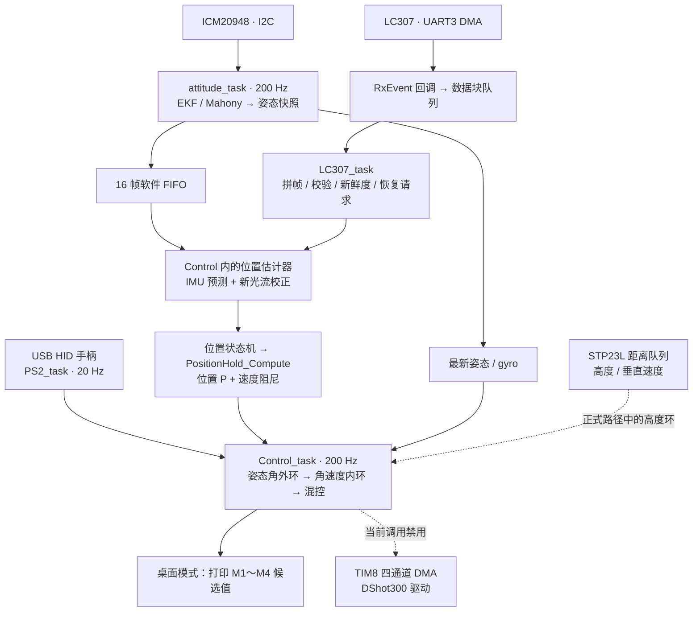

# F405 四旋翼飞控


以 **STM32F405RG + FreeRTOS** 为平台，围绕四旋翼的传感器采集、姿态估计、光流融合和控制计算展开开发。工程保留 **四元数 EKF / Mahony 两种姿态算法**，将 **200 Hz IMU 预测、约 50 Hz 光流校正、位置 PD、串级姿态 PID 与四路混控**连接为可观察的数据链，并提供 Keil 与 CMake/GCC 两套构建入口。

`STM32F405RG` · `ICM20948` · `EKF / Mahony` · `FreeRTOS` · `UART DMA` · `软件 FIFO` · `CMake + GCC`

[开发重点](#highlights) · [架构与数据流](#architecture) · [实验记录](#experiments) · [构建与使用](#build) · [验证状态](#status)

> **当前版本：桌面计算验证。** `POS_DESKTOP_TEST=1`，电机初始化与发送调用保持禁用；位置环修正参与姿态与混控候选值计算，供串口观察。当前模式使用固定基础油门、固定光流高度，高度环修正不进入混控。

<a id="highlights"></a>
## 开发重点

### 01 · 四元数 EKF 与 Mahony 姿态解算

- **统一算法接口**：采集 ICM20948 加速度与角速度，经同一姿态接口选择 EKF 或 Mahony；当前入口选择 EKF。
- **六状态 EKF**：状态为四元数 `q0～q3` 与陀螺仪 `bias_gx / bias_gy`，实现姿态预测、协方差传播及重力方向量测更新；加速度偏离可信区间时增大量测噪声。
- **Mahony 非线性互补滤波**：利用重力方向误差修正角速度，传播并归一化四元数，保留为另一条对照算法路径。
- **统一单位与零点**：加速度 `m/s²`、角速度 `rad/s`、姿态角 `rad`；解算后发布同一轮姿态、IMU、时间戳和序号。

源码入口：[算法选择](F405_BSP/attitude_algorithm.c) · [EKF](F405_BSP/Bsp_imu_ekf.c) · [Mahony](F405_BSP/Bsp_mahony.c) · [IMU 驱动](F405_BSP/Bsp_imu.c)

**九轴姿态解算扩展**：硬件采用集成磁力计的 ICM20948。当前驱动中的磁力计初始化仍被注释，解算输入只有加速度与陀螺仪，实际运行的是六轴融合；磁力计采集、校准与航向观测更新列入后续扩展。当前 Yaw 不具备磁北绝对航向约束。

### 02 · FreeRTOS 下的实时数据链

- **UART DMA → ISR 队列 → 任务解析**：光流中断只交付数据块和接收时刻；任务完成拼帧、帧头/长度/XOR/帧尾及积分时间检查。
- **DMA 恢复所有权**：LC307 运行期的接收启动与中止由 LC307 任务执行，中断提交请求；区分 HT、TC、IDLE 事件。
- **软件 FIFO**：16 帧固定数组保存已解算的 IMU 快照，位置估计器按原时间戳顺序消费；积压有界，溢出保留较新数据并累计计数。
- **短临界区**：共享快照和计数的复制受保护；姿态解算、滤波与积分在临界区外执行。

FIFO 位于姿态解算之后，用于保存位置预测所需的历史快照；它不等同于芯片硬件 FIFO，也不会提高当前 200 Hz 的软件读取频率。姿态算法仍使用原有固定 `dt=0.005 s`，位置预测使用相邻快照时间戳之差。

源码入口：[任务创建](Core/Src/freertos.c) · [串口回调](F405_APP/uart_callback.c) · [快照与 FIFO](F405_BSP/attitude_task.c) · [FIFO 说明](notes/IMU_Software_FIFO.md)

### 03 · 光流融合、位置 PD 与串级控制

- **多频率处理**：控制任务调用位置估计器逐帧执行 IMU 预测；仅对新光流观测进行一次校正，一批积压样本在末帧使用最新光流。
- **物理量处理**：保留已验证的光流轴映射、旋转补偿、重力补偿与死区处理；速度按 `0.95 × 预测 + 0.05 × 光流观测` 融合，再进行相对位置积分。
- **位置 PD**：`倾角需求 = Kp × 位置误差 − Kv × 实际速度`，输出为弧度，不含位置积分项。
- **单一控制入口**：`PositionHold_Compute()`只计算位置修正；`Control_task`负责启停、恢复、目标捕获、附加倾角、姿态内外环和混控。
- **失效处理**：光流超过 100 ms 无有效帧时撤销有效标志；位置附加倾角清零，恢复阶段重新等待观测并捕获目标。位置超差具有故障锁存路径。

本工程采用自定义命名：**X 向右、Y 向前；Roll 抬头为正、Pitch 右压为正**。当前位置需求映射为 `pitch_add=control_x`、`roll_add=-control_y`，阅读控制代码时应以此约定为准。

源码入口：[光流解析与估计](F405_BSP/LC307_task.c) · [位置 PD](F405_BSP/Position_hold.c) · [控制集成](F405_BSP/Control_task.c) · [串级 PID](F405_BSP/pid.c)

<a id="architecture"></a>
## 架构与数据流



图中虚线表示条件路径。光流旋转补偿使用接收任务取得的最新 gyro；当前没有按传感器内部硬件时间戳做严格同步。

| 任务 | 配置周期 / 触发 | 优先级 | 主要职责 |
| --- | --- | --- | --- |
| `attitude_task` | 200 Hz | 3 | I2C 读取、姿态解算、快照和 FIFO 发布 |
| `control_task` | 200 Hz | 2 | 位置预测、控制状态机、姿态 PID 与混控 |
| `LC307_task` | 队列触发，最长等待 5 ms | 2 | 光流解析、有效性检查、接收维护 |
| `PS2_task` | 20 Hz | 2 | 手柄指令映射与队列交付 |

此外，测距、电源、蓝牙、显示分别由独立任务处理。表中频率是源码配置值，不代表本次发布重新测得的实时性能。

<a id="experiments"></a>
## 实验与分析记录

### 板端姿态输出：EKF / Mahony

两张截图来自相同单位和静止条件下的历史串口观察，算法归属由作者确认。点击图片可查看完整记录。

<p align="center">
  <a href="docs/media/attitude_ekf_static.png"></a>
  <a href="docs/media/attitude_mahony_static.png"></a>
</p>

| 历史记录 | 左图：EKF | 右图：Mahony |
| --- | --- | --- |
| 保存时刻 | 2026-09-22 22:49:31 | 2026-09-22 22:52:08 |
| Roll 截图显示区间 | −0.018～−0.013 | −0.068～−0.065 |
| Pitch 截图显示区间 | −0.009～0.000 | 0.113～0.117 |

区间只摘取截图中可见数值，未做单位换算。在这次静置观察中，EKF 的 Roll/Pitch 更接近当时设置的零点；两图的 Yaw 参考值不同，不直接比较绝对值。截图不包含完整日志、真值和统一零点校准记录，因此不据此宣称绝对精度或给出通用算法排名。

<details>
<summary>MATLAB 姿态跟踪与陀螺仪零偏分析</summary>


这两张历史分析截图的图例是“一维 KF / 四元数 EKF”，与上面的 EKF / Mahony 板端串口对照属于不同记录。图中标注的真实角度和真实零偏用于当时的分析，不能当作当前实机地面真值。相应脚本与完整数据尚未收录，暂不提供可复现误差指标。

</details>

### 推力—电压—油门拟合


基础油门函数采用推力 `T` 与电压 `V` 的二次模型，包含 `T²`、`T×V`、`V²` 项，输出限制在原代码的 48～1148 范围。系数与实现位于 [`Weight_To_Throttle()`](F405_BSP/Control_task.c)；**当前桌面模式固定 `BASE=770`，不调用该拟合函数**。

<details>
<summary>查看拟合对照与残差图</summary>


图中的 R²、RMSE 和 MAE 随原图保留。本仓库暂未收录对应原始采样表及拟合脚本，未在本次发布重算这些统计；它们不代表当前固件的飞行性能或另一套动力系统的可复用标定。

</details>

[图片索引与记录边界](docs/media/README.md)

## 工程入口与目录

| 项目 | 当前配置 |
| --- | --- |
| 主控 | STM32F405RG / Cortex-M4F |
| IMU | ICM20948，I2C 读取加速度与陀螺仪 |
| 水平观测 | LC307，UART3 + DMA Normal |
| 测距 | STP23L，UART5；当前安装与代码按向上距离构造相对高度 |
| 遥控 | USB Host HID 手柄接收器 |
| 电机驱动 | TIM8 四通道 DMA / DShot300，当前控制调用禁用 |
| 串口日志 | USART1，256000 baud、8N1 |
| 构建 | Keil ARMCC5 / CMake + GNU Arm GCC / C99 |
| APP 布局 | `0x08010000` 起始，预留前 64 KiB Bootloader 区域 |

```text
.
├── Core/                 CubeMX 初始化、中断、FreeRTOS 资源与任务创建
├── F405_BSP/             传感器、姿态解算、FIFO、位置 PD、PID 与混控
│   └── Inc/              模块公共接口
├── F405_APP/             串口回调与接收请求交付
├── Drivers/              STM32 HAL 与 CMSIS
├── Middlewares/          FreeRTOS、USB 中间件
├── USB_HOST/             USB Host 应用与板级适配
├── MDK-ARM/              Keil 工程和 ARM 启动文件
├── cmake/                GCC 工具链与显式源码清单
├── GCC/                  GCC 启动文件、链接脚本和运行库适配
├── tools/                Windows 构建入口
├── notes/                开发、对接与历史笔记
└── docs/media/           展示封面、姿态截图和拟合记录
```

<a id="build"></a>
## 构建与使用

### VS Code / CMake / GCC

准备 **CMake ≥ 3.21、Ninja、GNU Arm GCC**。在工程根目录执行：

```sh
cmake --preset Debug
cmake --build --preset Debug
```

Windows 也可使用脚本，从 `CUBE_BUNDLE_PATH` 或 PATH 定位工具：

```powershell
.	oolsuild.ps1 -Configuration Debug
```

VS Code 默认构建任务为 **Ctrl+Shift+B**。产物位于 `build/gcc-Debug/`：`F405.bin`、`F405.elf`、`F405.hex`、`F405.map`。Release 对应 `build/gcc-Release/`。芯片编译参数为 Cortex-M4、Thumb、`fpv4-sp-d16`、硬件浮点 ABI；Debug 使用 `-O0`，Release 使用 `-Os`。

### Keil 与串口观察

1. 打开 [`MDK-ARM/F405-_FlightControl.uvprojx`](MDK-ARM/F405-_FlightControl.uvprojx)，使用 ARMCC5 构建。两套工程共用 C/H 文件，新增源码时需分别维护 Keil 与 CMake 文件清单。
2. GCC 固件选择本轮生成的 `build/gcc-Debug/F405.bin`，通过与现有 Bootloader 匹配的应用烧录流程写入；不要把 APP BIN 当作完整 Flash 镜像写到 `0x08000000`。
3. 烧录工具释放串口后，以 **256000、8N1** 打开日志，再复位观察启动和传感器初始化信息。只有启用的打印段会输出数据。
4. 当前桌面模式下，静置完成标定后长按 **START** 开始候选输出计算，单击或双击停止；`POS_MOTOR` 是四路油门指令候选值，不是实测转速。

详细说明：[VS Code / GCC 构建与 Keil 符号调试](README_CMAKE.md)。当前代码并未收录自编 Bootloader 的固件接收、Flash 更新或回滚实现。

<a id="status"></a>
## 验证状态与后续工作

| 内容 | 当前依据与状态 |
| --- | --- |
| EKF / Mahony 路径 | 源码已实现；保留上述历史静止观察与分析图片 |
| 光流方向、旋转/重力补偿、位置 PD 符号 | 开发过程中有人工串口观察；未形成统一自动化验收数据集 |
| 200 Hz 预测 / 约 50 Hz 校正 | 配置与计数路径已实现，历史日志观察过此关系；最新 FIFO 版需重新确认 |
| FIFO、超时与恢复分支 | 源码已接入；FIFO 溢出、断流与恢复的完整上机验证未完成 |
| 构建 | 既有 Windows GCC Debug/Release 构建记录；本次目录改名后的完整构建未执行 |
| 飞行 | 早期姿态控制版本有开发者试飞反馈；当前 FIFO 与位置控制版本未完成飞行验收，未提供对应视频 |
| 九轴磁力计融合 | 当前未接入，待补充采集、校准和融合 |

当前仍需关注的工程边界：

- 光流高度暂固定为 **0.005 m**，用于桌面计算；真实工作距离与尺度尚待重新标定。
- 正式位置模式的方向/尺度确认宏仍为 `0`，桌面模式绕过部分正式门限；不能仅切换一个宏就视作可飞版本。
- 位置控制有观测过期、间隔、姿态/速度/位移等检查；手柄断连、DMA 异常恢复和整机故障路径仍需组合验证。
- 当前快照时间为软件读数完成时刻；姿态固定 dt、光流与 gyro 的严格时间配对均有进一步改进空间。

后续优先补充：**磁力计与九轴融合 → 原始日志和 MATLAB 脚本 → 真实尺度与失效恢复验证 → 当前版本闭环飞行记录**。

## 开发笔记与许可

- [光流、位置 PD 与 RTOS 对接](notes/LC307_Position_PD.md)
- [IMU 软件 FIFO 接入说明](notes/IMU_Software_FIFO.md)
- [EKF、PID 与混控历史笔记](notes/EKF_PID_Mixer.md)
- [光流与 RTOS 原始笔记存档](notes/OpticalFlow_RTOS_original_20261015.txt)

历史笔记用于保留开发过程，涉及旧方向、旧开关或旧任务设计时，以当前源码与本页状态说明为准。

保留原仓库的 [MIT 许可证](LICENSE)及源文件中的版权声明；STM32 HAL、CMSIS、FreeRTOS、USB 等第三方组件遵循各自原有许可，见 [第三方组件说明](docs/THIRD_PARTY.md)与 [GCC 适配文件来源](GCC/THIRD_PARTY.md)。
