# 自研四旋翼飞控

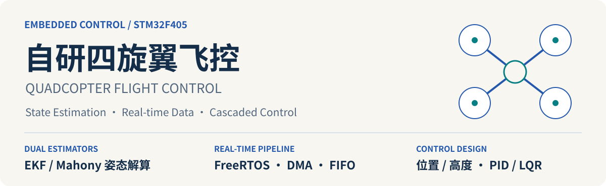

基于 **STM32F405 + FreeRTOS**，围绕九轴 IMU 平台，集成 **EKF / Mahony 双姿态解算、光流融合、位置与高度控制**，配套 **PID / LQR 控制方案分析**。

`9-axis IMU 硬件` · `Quaternion EKF` · `Mahony` · `FreeRTOS` · `DMA + FIFO` · `Position / Altitude` · `CMake + GCC`

[姿态解算 / Estimation](#estimation) · [控制设计 / Control](#control) · [系统架构 / Architecture](#architecture) · [实验记录 / Experiments](#experiments) · [构建 / Build](#build)

<a id="estimation"></a>
## 双姿态解算 / Dual Attitude Estimation

统一采集、统一单位、统一输出接口；通过 `Attitude_Init()` 选择四元数 EKF 或 Mahony，保留两条可切换的解算路径。

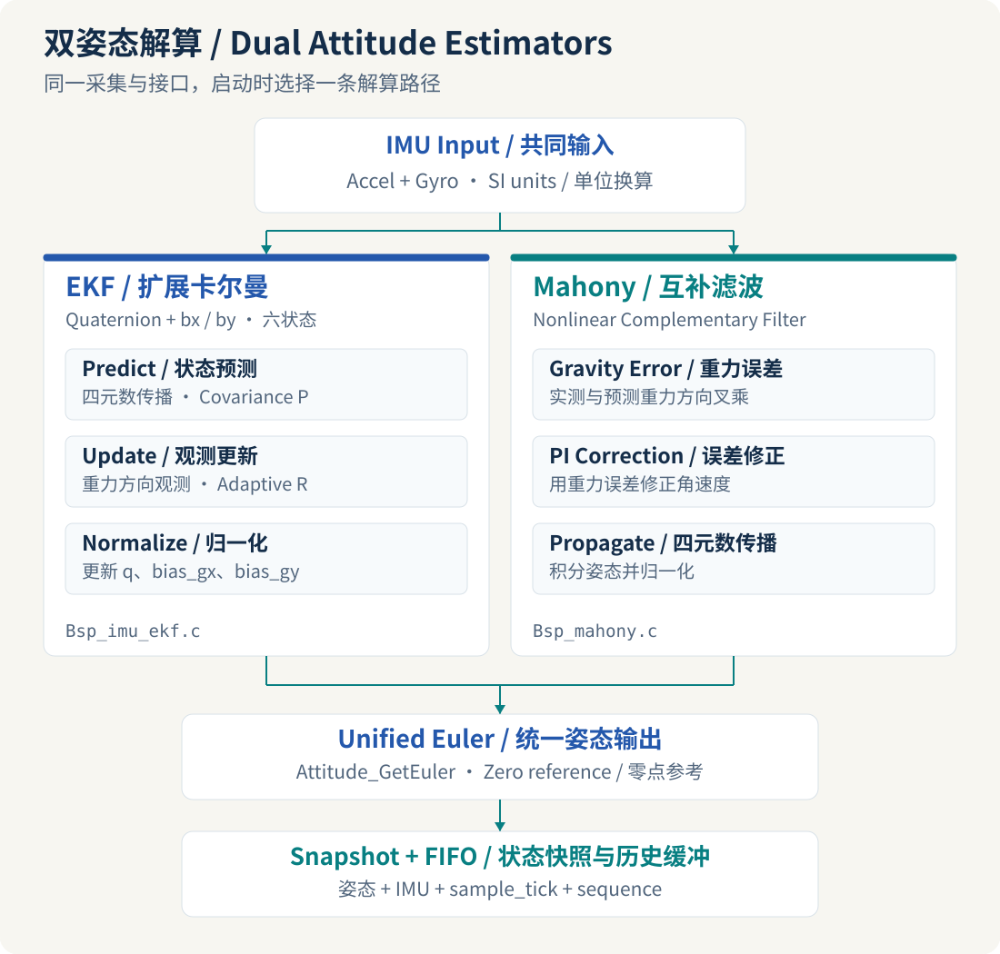

| 路径 / Method | 核心设计 / Core Design |
| --- | --- |
| **Quaternion EKF / 扩展卡尔曼** | 四元数与双轴 gyro 零偏组成六状态；姿态预测、协方差传播、重力方向量测更新、自适应量测噪声 |
| **Mahony / 非线性互补滤波** | 重力方向叉乘误差、PI 角速度修正、四元数传播与归一化 |
| **Snapshot / 一致快照** | 姿态、加速度、角速度、时间戳与序号同步发布，供控制端读取 |
| **FIFO / 历史缓冲** | 固定容量软件环形队列，顺序消费、溢出计数和样本连续性检查 |

**Sensor scope / 传感器范围：** ICM20948 是九轴器件；当前融合输入为三轴加速度和三轴角速度，磁力计航向观测不在当前滤波链路中。

[EKF](F405_BSP/Bsp_imu_ekf.c) · [Mahony](F405_BSP/Bsp_mahony.c) · [Algorithm Interface / 算法接口](F405_BSP/attitude_algorithm.c) · [Snapshot & FIFO / 快照与缓冲](F405_BSP/attitude_task.c)

<a id="control"></a>
## 控制设计 / Control Design

### Cascaded PID × LQR / 双控制方法

| 方法 / Method | 设计主线 / Design | 作用范围 / Scope |
| --- | --- | --- |
| **Cascaded PID / 串级控制** | Angle loop → Rate loop → Mixer，结合输出限幅、积分限幅与微分低通 | 当前板端固件 |
| **LQR / 线性二次型调节器** | Hover model → State feedback → Q/R weighting，统一考虑姿态误差与控制代价 | 离线控制设计对照 |

LQR 以状态反馈方案呈现，不参与当前固件混控。[PID / LQR 设计说明](docs/control/PID_LQR.md)

### Position Hold / 光流位置控制

`Optical Flow → Rotation Compensation → IMU Prediction → Flow Correction → Position PD`

光流角速度完成轴映射、旋转补偿与高度缩放；IMU 预测与新光流观测进行互补融合，积分得到相对位置。位置控制采用 **位置 P + 速度阻尼**，生成附加倾角，再由原姿态内外环处理。

```text
control_x = Kp_x × (target_x − x) − Kv_x × vx
control_y = Kp_y × (target_y − y) − Kv_y × vy
```

坐标约定：**X 向右、Y 向前；Roll 抬头为正、Pitch 右压为正**。当前位置输出映射为 `pitch_add=control_x`、`roll_add=-control_y`。

[Flow Estimator / 光流估计](F405_BSP/LC307_task.c) · [Position PD / 位置控制](F405_BSP/Position_hold.c) · [Control Integration / 控制集成](F405_BSP/Control_task.c)

### Altitude Hold / 高度串级控制

STP23L 提供测距输入，以初始距离为参考构造相对高度；高度差分经一阶低通得到垂直速度，依次进入高度外环与速度内环。内环输出作为 **Common Throttle / 公共油门修正**叠加到四路混控。

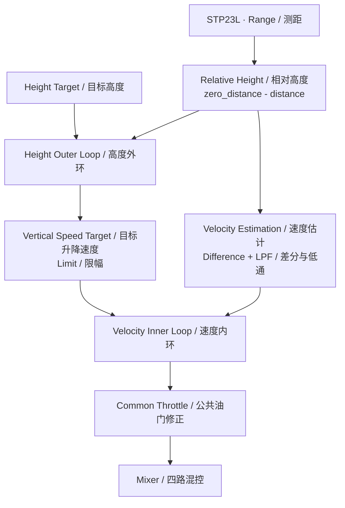

高度控制路径由运行模式选择；默认 Bench 模式将高度修正置零。[Height & Mixer / 高度与混控源码](F405_BSP/Control_task.c)

<a id="architecture"></a>
## 系统架构 / System Architecture

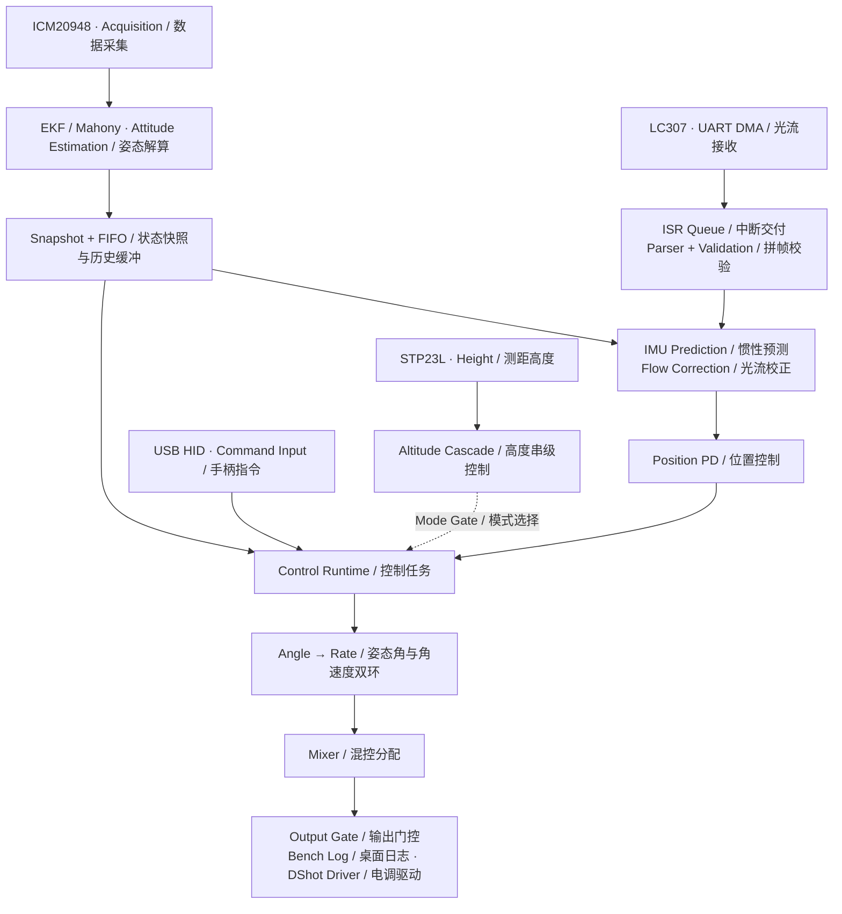

### Real-time Data Pipeline / 实时数据链

- **ISR → Queue → Task / 中断到任务**：UART DMA 交付数据块，任务负责解析、校验和接收维护。
- **Ownership / 接收所有权**：LC307 任务统一处理 DMA 启动与恢复请求，区分 HT、TC、IDLE。
- **Time & Sequence / 时间与序号**：位置预测沿用样本时间戳；同一 IMU 样本不重复预测，同一光流观测不重复校正。
- **Short Critical Sections / 短临界区**：共享快照、FIFO 单帧复制与计数更新受保护，解算和积分在临界区外完成。

[RTOS Bootstrap / 任务与资源创建](Core/Src/freertos.c) · [UART Callbacks / 串口回调](F405_APP/uart_callback.c) · [FIFO Notes / 缓冲机制](notes/IMU_Software_FIFO.md)

### Recovery Boundaries / 恢复边界

接收维护、估计暂停和位置控制重入采用独立状态路径，恢复观测与恢复控制分别处理。

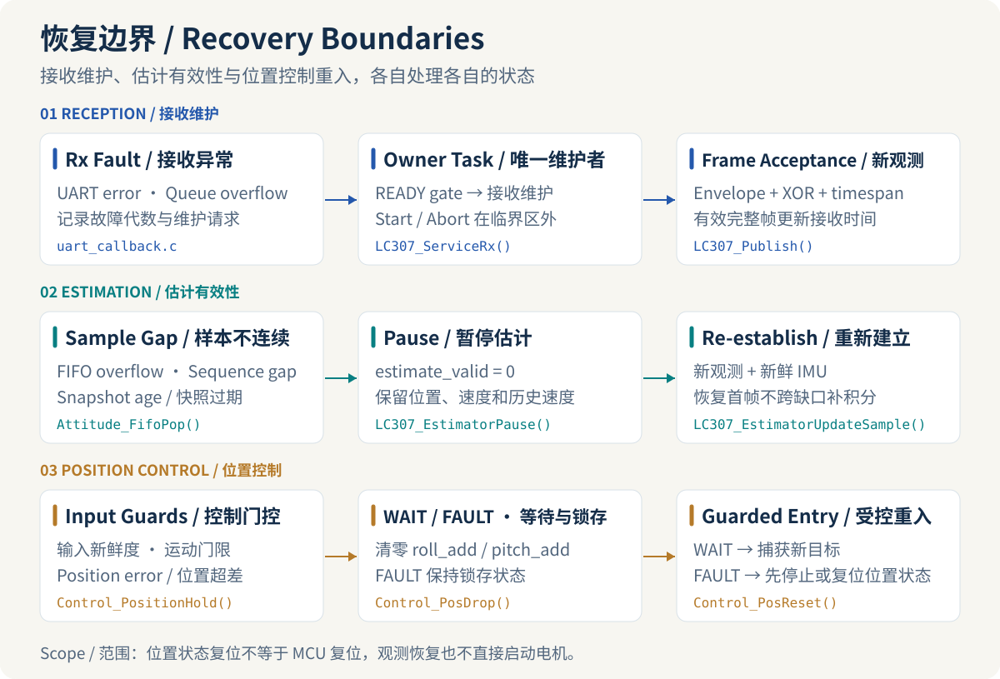

### Repository Map / 工程分层与职责

```text
quadcopter-fc/
├── Core/          Platform & RTOS Bootstrap / 平台初始化、调度资源、中断入口
├── F405_BSP/      Sensing · Estimation · Control / 传感器、状态估计、控制模块
│   └── Inc/       Module Contracts / 模块接口与共享数据类型
├── F405_APP/      ISR-to-Task Integration / 串口交付、接收事件与维护请求
├── Drivers/       HAL & CMSIS / 外设驱动与 Cortex-M 支撑
├── Middlewares/   RTOS & USB Stacks / 实时内核与协议栈
├── USB_HOST/      HID Input Transport / 手柄接收与输入适配
├── MDK-ARM/       Keil Workspace / ARMCC 工程与启动入口
├── cmake/         Cross-build Toolchain / 交叉编译工具链与源码清单
├── GCC/           Startup · Linker · Runtime / 启动、内存布局、运行库适配
├── tools/         Build Automation / 构建脚本
├── notes/         Engineering Notes / 开发推导与集成记录
└── docs/          Design & Media / 控制设计、架构图与实验影像
```

<a id="experiments"></a>
## 实验记录 / Experiments & Analysis

### EKF vs Mahony / 静置姿态输出

相同单位与静止条件下的两次串口记录，左侧为 EKF、右侧为 Mahony。该次记录中，EKF 的 Roll/Pitch 更接近设置的零点；Yaw 参考不同，不比较绝对值。点击图片查看原图。

<p align="center">
  <a href="docs/media/attitude_ekf_static.png">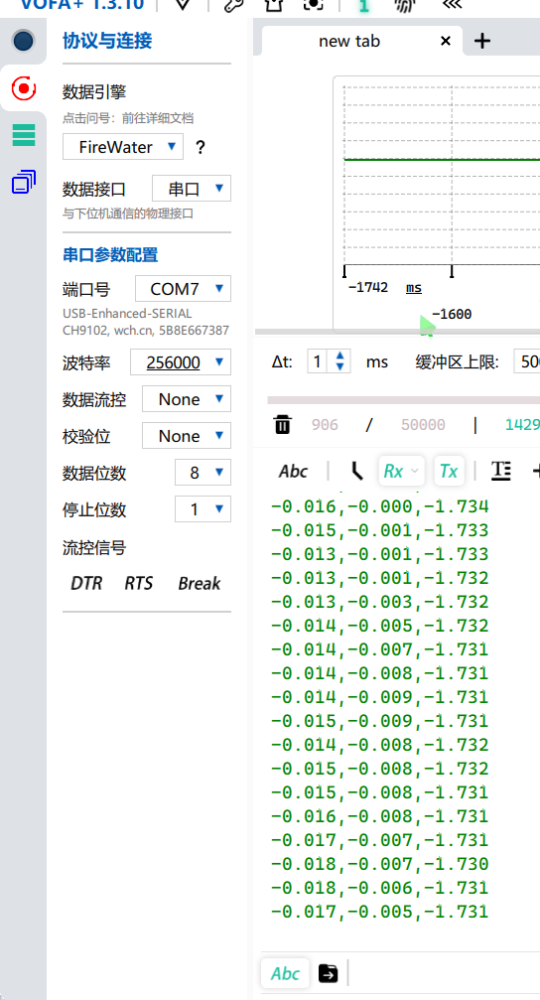</a>
  <a href="docs/media/attitude_mahony_static.png">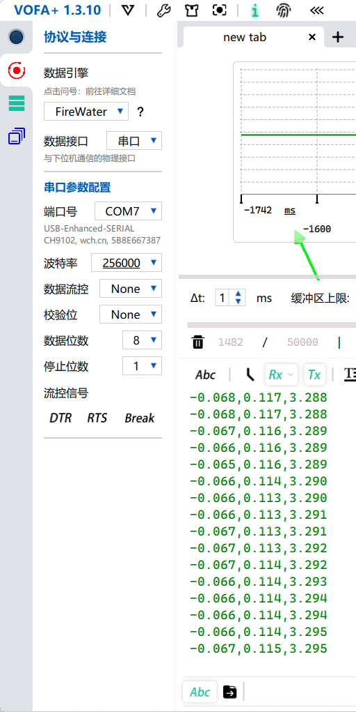</a>
</p>

<details>
<summary>MATLAB · Quaternion EKF Analysis / 四元数与零偏分析</summary>

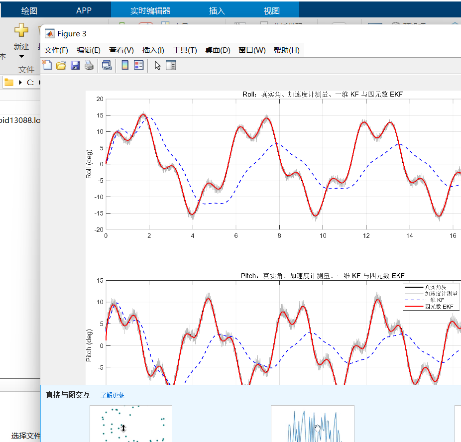

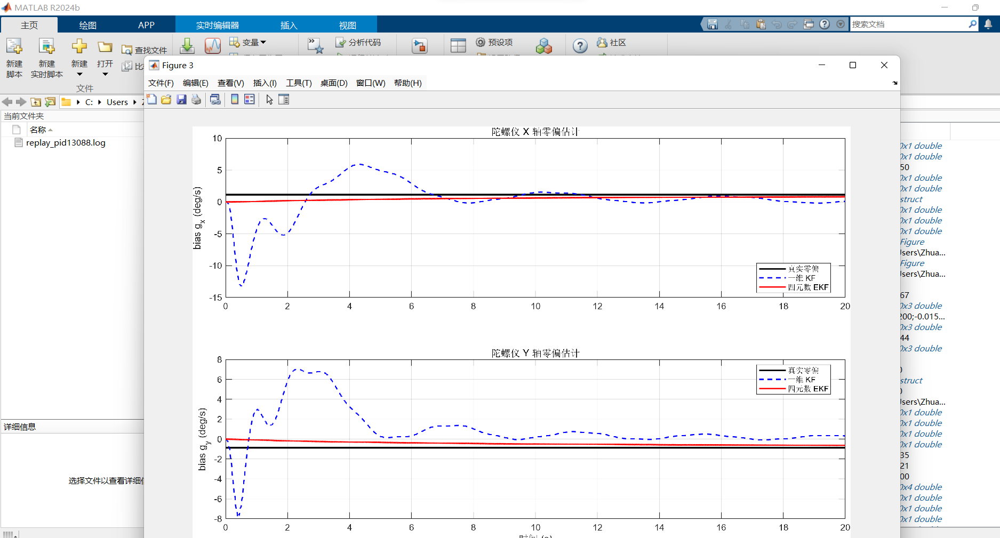

图例为一维 KF 与四元数 EKF，属于另一组分析记录，与上面的板端 EKF/Mahony 对照分别展示。

</details>

### Thrust–Voltage–Throttle / 动力模型拟合

以推力与电压为输入建立二次油门模型，包含平方项与交叉项；拟合系数保存在 [`Weight_To_Throttle()`](F405_BSP/Control_task.c)。图中为历史拟合记录，统计值随原图保留。

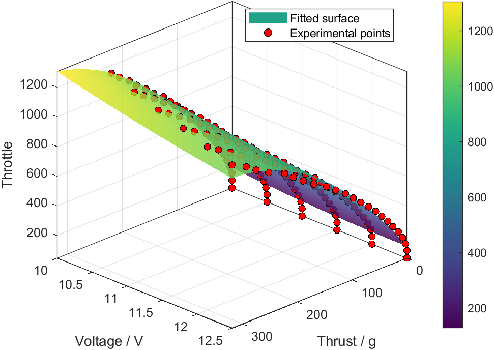

<details>
<summary>Fit Comparison & Residuals / 拟合对照与残差</summary>

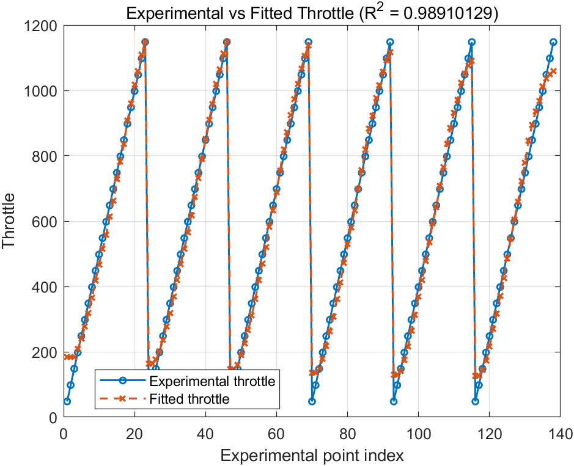

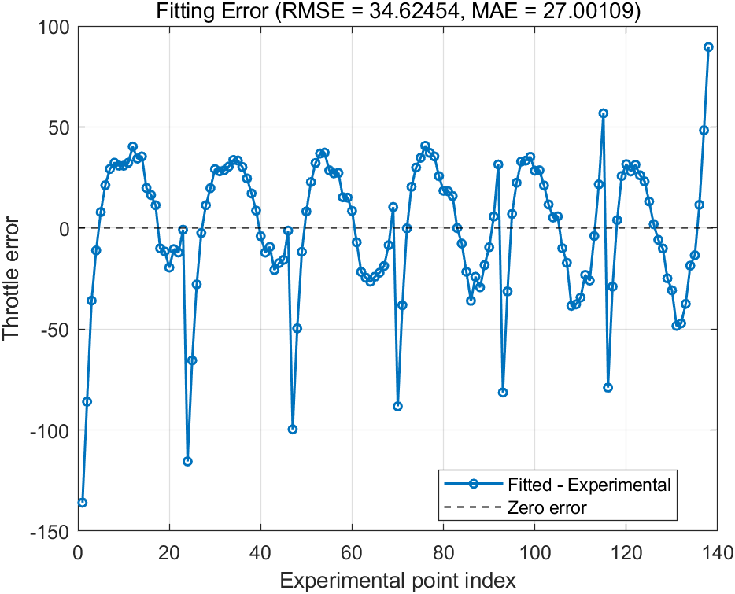

</details>

[Media Index / 图片索引与测试条件](docs/media/README.md)

<a id="build"></a>
## 技术栈与构建 / Platform & Build

| 层级 / Layer | 配置 / Configuration |
| --- | --- |
| MCU / 主控 | STM32F405RG · Cortex-M4F |
| IMU / 惯性器件 | ICM20948 · 9-axis hardware / 九轴硬件 |
| Estimation / 姿态估计 | Quaternion EKF / Mahony · Accel + Gyro fusion |
| Runtime / 实时系统 | FreeRTOS · CMSIS-RTOS v2 · Queue / Mutex / FIFO |
| Position / 水平观测 | LC307 · UART DMA · Position PD |
| Altitude / 高度观测 | STP23L · Relative height · Cascaded control |
| Actuation / 执行接口 | TIM8 DMA · DShot300 |
| Bootloader / 启动兼容 | 预留 64 KiB，APP 起始 `0x08010000` |
| Toolchain / 工具链 | Keil ARMCC5 / GNU Arm GCC · CMake · Ninja |
| Analysis / 控制分析 | MATLAB 分析记录 · PID / LQR design study |

在工程根目录使用 CMake：

```sh
cmake --preset Debug
cmake --build --preset Debug
```

Windows 构建脚本：

```powershell
./tools/build.ps1 -Configuration Debug
```

VS Code：**Ctrl+Shift+B**。GCC 产物为 `build/gcc-Debug/F405.bin` 与配套 ELF/HEX/MAP；工具从 `CUBE_BUNDLE_PATH` 或 PATH 定位。Keil 入口为 [`F405-_FlightControl.uvprojx`](MDK-ARM/F405-_FlightControl.uvprojx)，两套构建共用 C/H 源码。

**Default Output / 默认输出：** 当前提交为 `POS_DESKTOP_TEST=1` 的 Bench 计算模式，电机发送禁用，高度修正置零。通过现有 Bootloader 烧录 APP 时使用本轮 BIN；串口观察为 **256000、8N1**。

[Build Guide / GCC 与 Keil 使用说明](README_CMAKE.md) · [Control Parameters / 控制与运行参数](notes/LC307_Position_PD.md)

## 开发记录与许可 / Notes & License

[EKF / PID / Mixer](notes/EKF_PID_Mixer.md) · [Optical Flow / 光流对接](notes/LC307_Position_PD.md) · [IMU FIFO](notes/IMU_Software_FIFO.md) · [原始笔记](notes/OpticalFlow_RTOS_original_20261015.txt)

保留 [MIT 许可证](LICENSE)及各源文件版权声明；第三方组件遵循各自许可，见 [Third-party Notices / 组件说明](docs/THIRD_PARTY.md)与 [GCC Sources / 适配来源](GCC/THIRD_PARTY.md)。
