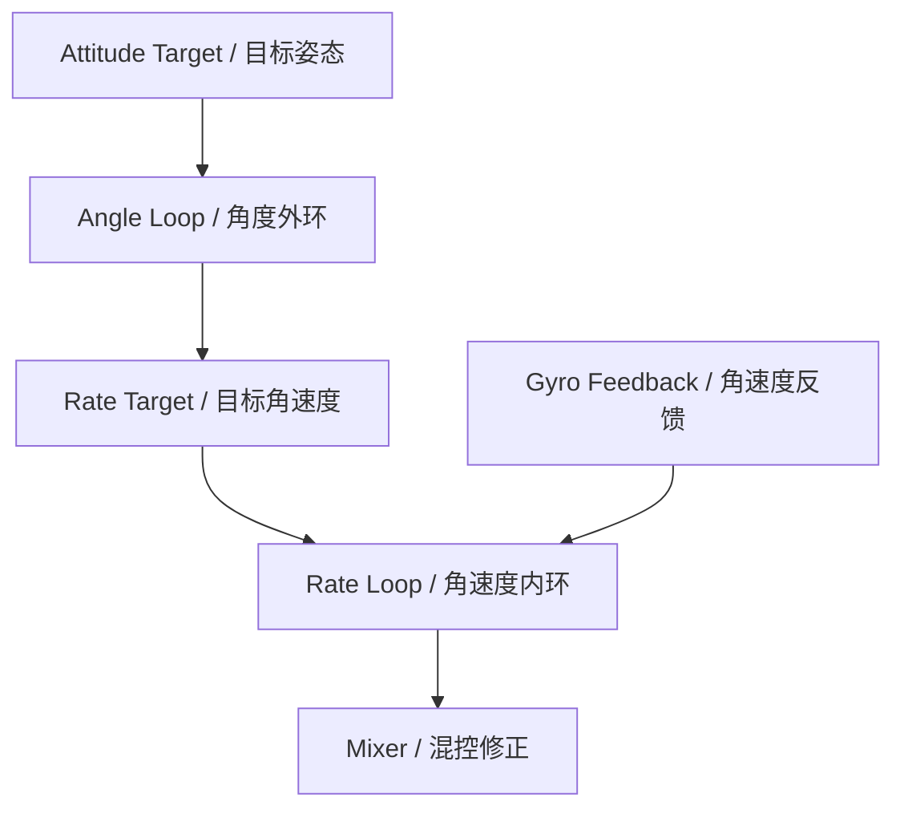
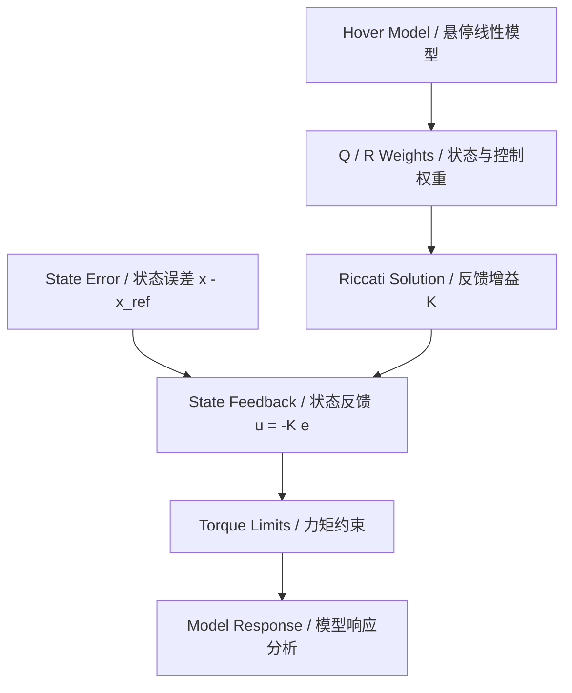

# PID / LQR Control Design · 双控制方法

本文把板端串级PID与离线LQR设计放在同一控制问题下讨论。PID对应现有固件，LQR是模型与状态反馈设计说明，不是当前固件的另一套运行控制器，也不提供实飞或仿真误差排名。

## 1. Cascaded PID / 板端串级控制

当前数据链为：



位置PD输出附加倾角；高度速度内环输出公共油门修正。角度和角速度反馈仍沿用现有工程的轴定义。PID限幅、积分阈值与微分低通见 [pid.c](../../F405_BSP/pid.c)，控制集成见 [Control_task.c](../../F405_BSP/Control_task.c)。

## 2. LQR / 悬停附近的状态反馈设计

采用悬停附近、小角度、刚体惯量为常数的设计模型。状态和输入可写为：

```text
x = [alpha_x, alpha_y, alpha_z, omega_x, omega_y, omega_z]^T
u = [tau_x, tau_y, tau_z]^T

x_dot = A x + B u

A = [ 0_(3×3)  I_(3×3) ]
    [ 0_(3×3)  0_(3×3) ]

B = [ 0_(3×3) ]
    [ J_body^-1 ]

J_body = diag(Jx, Jy, Jz)
```

`alpha`是模型中的小角度姿态量，`omega`为对应角速度，`tau`为力矩。模型轴不能直接套用常见飞控的Roll/Pitch命名，应与本工程实测方向建立映射；大角度运动不满足这里的简化关系。

通过状态代价Q与输入代价R平衡姿态误差、角速度和控制力矩：

```text
cost = integral( x_error^T Q x_error + u^T R u ) dt
u = -K x_error
x_error = x - x_reference
```

选定正定R与合适的半正定Q后，可用MATLAB的连续时间 `lqr(A,B,Q,R)`求增益K；离散模型对应 `dlqr`。角度误差使用“实际减参考”，Yaw差值需要先归一化。惯量和权重是设计输入，不在此填入未经测量的整机数值。



## 3. Interface Boundary / 两种输出不能直接替换

| 项目 | 串级PID固件 | LQR设计模型 |
| --- | --- | --- |
| 输入 | 姿态角、角速度、目标值 | 状态误差与模型参数 |
| 输出 | 现有工程定义的混控修正量 | 模型力矩，单位N·m |
| 参数 | PID增益、积分与输出限幅 | 惯量、Q、R、反馈增益K |
| 与电机的关系 | 进入现有Mixer | 需明确力矩到电机的分配与标定 |

LQR的力矩不能直接当作当前PID混控修正量相加。比较两种方法时，应使用相同模型、参考指令、执行约束、扰动和初始状态；控制周期、饱和与坐标映射也需要保持一致。

官方接口参考：[MathWorks — lqr](https://www.mathworks.com/help/control/ref/lti.lqr.html)。
